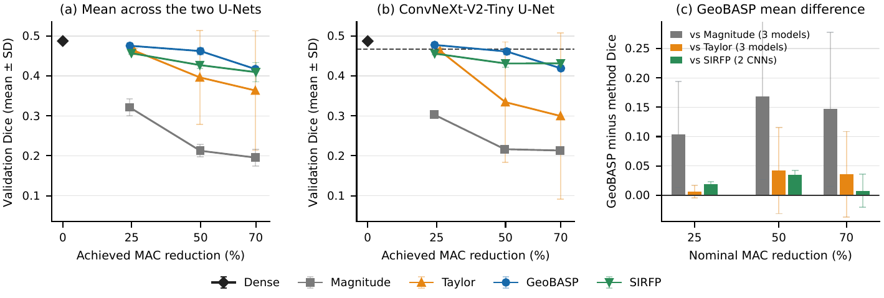

# GeoBASP

Code and released models for **GeoBASP: Geography-Aware Structured Pruning for Landslide-Scar Segmentation in the Nepal Himalaya** (accepted in *Electronics*; DOI pending).

[Download data and models](https://github.com/ghimiredhikura/GeoBASP/releases/tag/v1.0.0) · [Full reproduction guide](docs/REPRODUCING.md) · [Licenses and attribution](docs/LICENSES.md)

## Quick start

Use a Python environment with the packages in `requirements.txt`. From a terminal:

```bash
git clone https://github.com/ghimiredhikura/GeoBASP.git
cd GeoBASP
python main.py data download
python main.py data prepare
python main.py models
```

Evaluate the released ConvNeXt-V2-Tiny GeoBASP model at 25% MAC reduction. The first command selects its threshold on validation data; the second applies that threshold to the test set:

```bash
python main.py threshold --checkpoint models/convnextv2_tiny/geobasp_mac25_seed2028.pt --step 0.005 --output generated/threshold.json
python main.py evaluate --checkpoint models/convnextv2_tiny/geobasp_mac25_seed2028.pt --threshold-report generated/threshold.json --split test --output generated/test.json
```

<details>
<summary>Train and reproduce the full study</summary>

Training and pruning require CUDA. To train a dense model and preview or run the pruning comparison:

```bash
python main.py train --profile convnextv2_tiny
python main.py experiments main --plan
python main.py experiments main
python main.py experiments sirfp
```

Profiles `resnet50` and `segformer_b2` are also available. Add `--dense-root generated/dense_models` to an experiment to use freshly trained dense models. See the [reproduction guide](docs/REPRODUCING.md) for data sources, all experiments, summaries and latency measurement.

</details>

## Sample results



**Figure 4.** Validation Dice across MAC targets. SIRFP was evaluated on the two U-Nets; the other methods also include SegFormer-B2.

**Table 4, selected columns.** ConvNeXt-V2-Tiny U-Net near 25% MAC reduction:

| Method | MAC reduction (%) | Params (M) | Validation Dice | Test Dice | NI | Latency (ms) |
| --- | ---: | ---: | ---: | ---: | :---: | ---: |
| Dense | 0 | 34.957 | 0.4873 | 0.5159 | -- | 31.31 ± 0.13 |
| Magnitude | 24.09 | 29.390 | 0.3058 | 0.3479 | No | **24.58 ± 0.04** |
| Taylor | 25.80 | 28.409 | 0.4620 | 0.4740 | No | 24.85 ± 0.02 |
| GeoBASP (Ours) | 24.22 | 30.648 | **0.4848** | 0.5054 | **Yes** | 25.58 ± 0.04 |
| SIRFP | 24.31 | **25.499** | 0.4580 | **0.5087** | No | 26.43 ± 0.18 |

**NI**: non-inferiority to dense under paired 20 km-block 95% intervals and a −0.02 Dice margin. Latency is CUDA Graph FP32 mean ± SD of three session medians on an RTX 5060 Laptop GPU; bold marks the best pruned value per column.

<details>
<summary>About these results</summary>

The table reports selected checkpoints. GeoBASP reduces MACs by 24.2% and latency by 18.3% at this operating point while passing the NI criterion. SIRFP has a higher global test Dice here, but does not meet that criterion. Figure 4 pools seed-level runs; comparisons with SIRFP use the same two architectures for every method.

</details>

The [source code](src/nepal_cnn/) is organized by workflow. Generated outputs stay local; the [release](https://github.com/ghimiredhikura/GeoBASP/releases/tag/v1.0.0) provides the original inventory and six main checkpoints. Original code is [MIT licensed](LICENSE); data and pretrained weights have separate terms in [Licenses and attribution](docs/LICENSES.md). Please cite the article and [ICIMOD inventory](https://doi.org/10.26066/rds.1973522).
